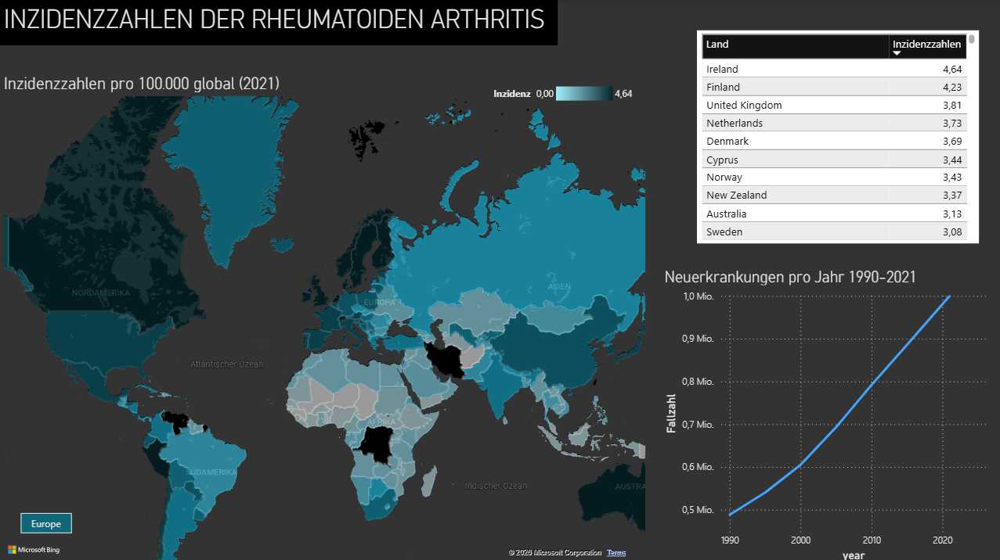
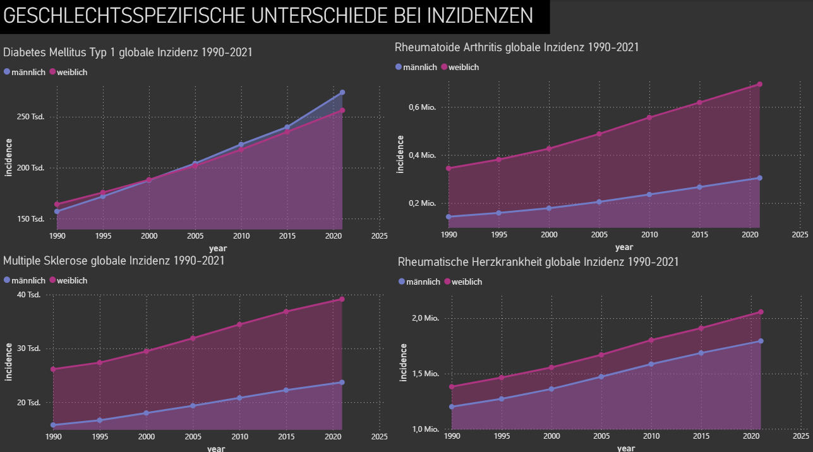
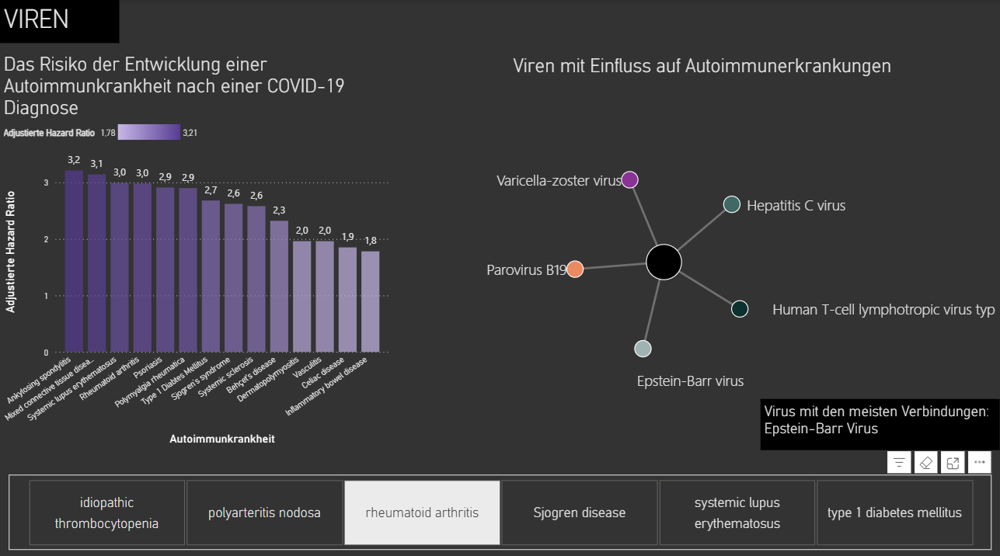
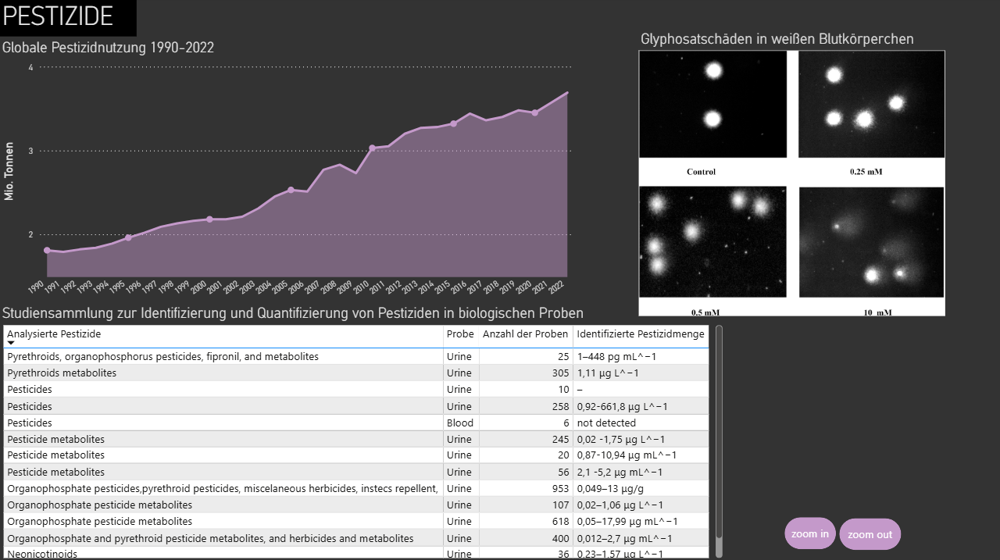

# Autoimmune Diseases – Data Analysis & Visualization

**Exploring epidemiological trends and potential risk factors of immune-mediated diseases using Microsoft Power BI.**

**Tech Stack:** Power BI · Power Query · DAX · Data Cleaning · Data Visualization · Exploratory Data Analysis

## Project Overview

Autoimmune diseases are a complex group of conditions in which the immune system mistakenly attacks the body's own tissues. Their development is influenced by a combination of genetic, environmental, and lifestyle-related factors, many of which are not yet fully understood.

This project explores the epidemiology of selected autoimmune and immune-mediated diseases, with a particular focus on rheumatoid arthritis (RA).

The analysis covers:

- Rheumatoid arthritis (RA)
- Multiple sclerosis (MS)
- Type 1 diabetes mellitus (T1D)
- Rheumatic heart disease (RHD)

The primary objective was to investigate global disease patterns, visualize epidemiological trends, and explore potential associations between disease incidence and environmental, biological, and lifestyle-related factors.

The project was developed independently as part of a university coursework assignment. This included selecting the research topic, identifying suitable datasets, cleaning and preparing data, developing interactive visualizations, and interpreting the results.

> **Note:** This project is an exploratory data analysis, not a clinical or causal investigation. Observed associations and geographical patterns do not establish causality.

## Research Questions

The analysis was guided by the following questions:

1. How has the incidence of selected immune-mediated diseases changed over time?
2. How does the incidence of rheumatoid arthritis differ across geographical regions?
3. What differences can be observed between male and female populations?
4. Which potential associations can be explored between autoimmune diseases and environmental or lifestyle-related factors?

## Data Sources

The project combines publicly available epidemiological datasets, population statistics, environmental data, and findings from scientific publications.

The main sources include:

| Source | Data / Purpose |
|---|---|
| Institute for Health Metrics and Evaluation (IHME) | Disease incidence, prevalence, and epidemiological trends |
| World Bank | Population statistics for country-level comparisons |
| World Health Organization (WHO) | Health indicators and population-related statistics |
| Our World in Data / FAOSTAT | Pesticide usage and environmental data |
| Scientific publications | Findings on immunological, environmental, and lifestyle-related factors |

Additional sources were consulted for specific analyses involving viral infections, smoking, the gut microbiome, and other potential risk factors.

The complete list of references is provided in the [project documentation](docs/project_documentation.pdf).

## Data Preparation & Processing

One of the main challenges was integrating data from multiple independent sources.

The datasets differed in structure, geographical identifiers, time periods, and measurement units. Several preprocessing steps were necessary before meaningful comparisons could be made.

### Data Cleaning

- Identified and corrected inconsistent numerical entries.
- Removed or corrected invalid characters in numerical columns.
- Harmonized country names and geographical identifiers.
- Matched country codes to their corresponding country names.
- Prepared datasets for use in Power BI.

### Data Integration

Population statistics were incorporated to enable comparisons between countries with different population sizes.

A particular challenge was reconciling inconsistencies between country identifiers across datasets.

### DAX Measures

Custom DAX measures were created to calculate incidence rates per 100,000 inhabitants:

\[
\text{Incidence Rate} = \frac{\text{New Cases}}{\text{Population}} \times 100{,}000
\]

This normalization enabled more meaningful comparisons across countries and regions than absolute case counts alone.

## Dashboard & Visualizations

The interactive Power BI report was organized into several thematic sections to make the findings accessible and understandable.

### 1. Global Distribution of Rheumatoid Arthritis

A choropleth map visualizes geographical differences in rheumatoid arthritis incidence.

A complementary time-series visualization illustrates changes in incidence between 1990 and 2021.

### 2. Solar Exposure & Geographical Patterns

A second geographical visualization compares solar energy potential across regions.

The visual comparison was used to explore the hypothesis of a possible association between solar exposure, vitamin D, and rheumatoid arthritis incidence.

These comparisons are exploratory and do not provide statistical evidence of causality.

### 3. Sex-Based Differences

Line charts illustrate differences in disease incidence between male and female populations across selected diseases.

Additional visualizations explore differences in selected immune cell measurements.

### 4. Viral Infections

An interactive network visualization presents relationships between selected viral infections and autoimmune diseases reported in scientific literature.

Additional charts summarize findings from research on autoimmune disease risk following COVID-19 infection.

### 5. Gut Microbiome & Nutrition

Grouped bar charts visualize findings from studies investigating the distribution of selected bacterial genera, particularly *Prevotella* and *Bacteroides*, among patients with inflammatory conditions.

### 6. Smoking & Rheumatoid Arthritis

Visualizations summarize research findings concerning smoking history, rheumatoid factor status, and rheumatoid arthritis risk.

### 7. Pesticide Exposure

Time-series visualizations illustrate global pesticide-use trends.

Scatterplots and trendlines were also used to explore potential associations between pesticide use and autoimmune disease incidence.

No clear relationship was identified in these exploratory comparisons.

## Dashboard Preview

Screenshots of the interactive Power BI dashboard will be included below.

### Global Incidence Analysis



### Additional Dashboard Visualizations
The following screenshots provide a preview of selected dashboards. To explore the complete collection of interactive visualizations, download and open the .pbix file in Microsoft Power BI Desktop.







## Challenges & Lessons Learned

This project involved several challenges that provided valuable experience with real-world data analysis.

**Data availability**

Finding suitable, publicly accessible medical datasets was challenging. Some data sources were incomplete, restricted, or incompatible with the intended analysis.

**Data consistency**

Combining datasets required harmonizing country names, country codes, and population figures. Differences between sources complicated data integration.

**Normalization**

Absolute disease counts were unsuitable for direct comparisons between countries of different population sizes. Calculating incidence rates per 100,000 inhabitants helped address this issue.

**Exploratory hypothesis testing**

An initial hypothesis concerned a possible relationship between pesticide use and autoimmune disease incidence. However, the scatterplots and trendlines did not reveal a clear association.

This highlighted the importance of critically evaluating hypotheses rather than assuming that expected relationships will be reflected in the data.

**Technical limitations**

An animated Play Axis visualization was initially tested to display geographical changes over time. However, repeated map rendering caused visual flickering.

After experimenting with different configurations, the feature was removed in favor of a more stable visualization.

## Limitations

Several limitations should be considered when interpreting the results:

- The analysis is exploratory and does not establish causal relationships.
- Data availability and quality varied across sources.
- Differences in data collection methods and reporting practices may affect international comparisons.
- Population normalization does not account for every demographic or epidemiological difference.
- Some visual comparisons were used to explore hypotheses without formal statistical testing.
- Genetic influences and other potentially relevant confounding factors were outside the scope of the project.

The visualizations should therefore be interpreted as descriptive analyses and illustrations of findings from the scientific literature rather than evidence of direct causal relationships.

## Conclusion

This project provided practical experience with the complete workflow of an exploratory data analytics project, from independent data acquisition to preprocessing, integration, visualization, and interpretation.

Working with heterogeneous medical and environmental datasets highlighted the importance of data quality, consistent measurements, and appropriate normalization.

Furthermore, the investigation of potential risk factors demonstrated the importance of distinguishing between observed patterns, statistical associations, and causal explanations.

The project strengthened my skills in data preparation, Power BI, DAX, and data-driven communication while allowing me to explore a topic of personal interest in digital health and medical data analysis.

## Repository Structure

```text
autoimmune-diseases-data-analysis/
├── README.md
├── autoimmune_diseases.pbix
├── docs/
│   ├── project_documentation.pdf
│   └── data_sources.md
├── images/
│   ├── dashboard_overview.png
│   └── dashboard_details.png
├── data/
│   ├── raw/
│   └── processed/
└── .gitignore
```

The `data/` directory is optional and contains only datasets that can legally be redistributed.

## How to Open the Dashboard

1. Install [Microsoft Power BI Desktop](https://www.microsoft.com/en-us/power-platform/products/power-bi/desktop).
2. Clone or download this repository.
3. Open `autoimmune_diseases.pbix` in Power BI Desktop.
4. Explore the report pages and interactive visualizations.

Some data connections or custom visualizations may require additional configuration depending on the local environment.

## Documentation

For a detailed explanation of the research background, methodology, visualization choices, technical challenges, and original references, see:

**[Full Project Documentation (PDF)](docs/project_documentation.pdf)**

The documentation was originally prepared in German as part of the university project.
